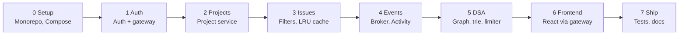
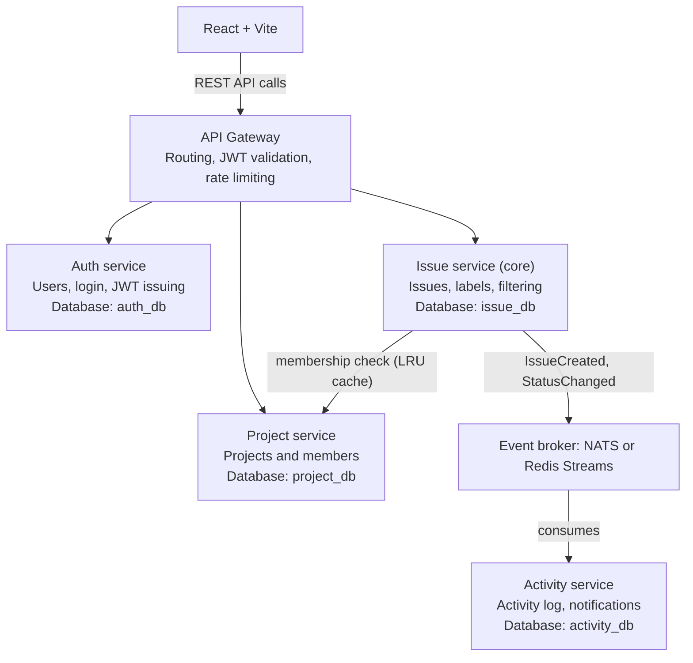
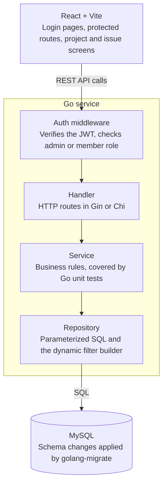

# Build Plan: Bug / Issue Tracker (Go microservices + MySQL + React)

The plan has two tracks. The **app track** is what you build, and the **assignment track** is what you document in each phase. Doing both together means your prompt history and context notes are written as you go, not reconstructed at the end.

## Workflow

Phases run in order: contracts and auth first, each service next, the frontend last, and every phase ends with its documentation.

## Services

The system is split into an API gateway and four services. Keep it to four, because each extra service adds its own setup, database, Dockerfile, tests and docs.

| Service | Owns | Own database |
|---|---|---|
| API Gateway | Routing, JWT validation, rate limiting | none |
| Auth service | Users, login, roles, JWT issuing | `auth_db` |
| Project service | Projects, members, permissions | `project_db` |
| Issue service (core) | Issues, labels, filtering, search | `issue_db` |
| Activity service | Activity log, comments feed, notifications | `activity_db` |

- **Database per service:** one MySQL container with separate databases is fine, but services never query each other's tables.
- **Sync calls:** gRPC or REST between services, for example the Issue service asking the Project service whether a user is a member.
- **Async events:** `IssueCreated` and `StatusChanged` go through a broker (NATS or Redis Streams), and the Activity service consumes them.
- **No cross-service joins:** the Issue service stores user IDs only, and names are enriched at the gateway or in the UI. Explain this choice in your architecture docs.

## Inside each service

Every service keeps the same four layers; the filter query builder in the Issue service's repository is the part to keep injection-safe.

## Professional practices

- Docker Compose to run everything with one command
- Config through environment variables, structured logging, and `/health` and `/ready` endpoints on every service
- OpenAPI specs (or `.proto` files for gRPC) kept in a `contracts/` folder
- GitHub Actions CI that runs lint, tests and build
- Unit tests plus a few integration tests for service-to-service calls
- Graceful shutdown, request IDs passed across services, and timeouts on every outgoing call

## Data structures and algorithms

These come up in a real tracker. Make each one a small, tested package with benchmarks, and keep the first four if you need to trim.

| Data structure / algorithm | Where it fits |
|---|---|
| LRU cache (hash map + doubly linked list) | Caches project-membership checks so the Issue service does not call the Project service every time |
| Graph + cycle detection + topological sort | "Blocked by" issue dependencies: reject circular dependencies and show a valid work order |
| Trie | Autocomplete for labels and usernames |
| Token bucket (or sliding window) | Rate limiter in the gateway |
| Min-heap / priority queue (optional) | "Next issue to work on" ordered by priority and due date |
| Union-Find (optional) | Grouping duplicate issues |
| Keyset (cursor) pagination | A faster alternative to `OFFSET` for large issue lists |

## Phase 0: Setup and foundation

**App**

- Monorepo layout: `services/`, `gateway/`, `contracts/`, `pkg/` (shared logging, config, request IDs), `frontend/`, `db/migrations/`, `docs/`
- Docker Compose with MySQL (one database per service) and golang-migrate
- GitHub Actions CI running lint, tests and build
- A health-check template (`/health`, `/ready`) reused by every service

**Assignment**

- Write a root `CLAUDE.md` and `AGENTS.md`, plus one `AGENTS.md` per service
- Connect the MySQL and GitHub MCP servers and note the configuration
- Start `PROMPTS.md` with your initial prompt
- Record the model and settings in `MODELS-MCP.md`

**Done when:** Compose starts every container, CI is green, and the first commit is pushed.

## Phase 1: Auth service and gateway

**App**

- Register and login with bcrypt password hashing and JWT
- Roles: `admin` and `member`
- Gateway routing and JWT validation, passing the user ID to the services
- OpenAPI spec for both in `contracts/`

**Tables:** `users` in `auth_db`

**Assignment:** Create a `db-migration` skill. Run `/compact` at the end of this phase and note what you preserved.

## Phase 2: Project service

**App**

- Create, read, update, and delete projects
- Add and remove project members
- A membership-check endpoint (gRPC or REST) for other services
- Gateway routes for the project API

**Tables:** `projects`, `project_members` in `project_db`

**Assignment:** Draft `ARCHITECTURE.md` with the services diagram and record any debugging prompts.

## Phase 3: Issue service (the core)

**App**

- Issue CRUD: title, description, priority, status (todo / in progress / done), assignee, reporter
- Labels per project, with many-to-many assignment to issues
- Membership check through the Project service, with a timeout and an LRU cache
- Filter by status, assignee, priority, and label (including multiple labels), plus keyword search and sorting
- Keyset pagination, and a safe dynamic query builder with parameterized SQL and no string concatenation
- Indexes for the common filters

**Tables:** `issues`, `labels`, `issue_labels` in `issue_db`

**Assignment:** Add a `code-reviewer` subagent and use it on this phase. Use the MySQL MCP to inspect the schema and test queries. Record the injection-safety and slow-query prompts, then compact the context again.

## Phase 4: Events and Activity service

**App**

- Add the broker (NATS or Redis Streams) to Compose
- The Issue service publishes `IssueCreated` and `StatusChanged`
- The Activity service consumes them, stores the log, and serves an activity feed
- Request IDs passed across services, and graceful shutdown

**Tables:** `activity_logs` in `activity_db`

**Assignment:** Add the event-flow diagram to `ARCHITECTURE.md` and record the debugging prompts.

## Phase 5: DSA packages

**App**

- Dependency graph in the Issue service with cycle detection and topological sort
- Trie for label and username autocomplete
- Token-bucket rate limiter in the gateway
- The LRU cache from Phase 3 as its own tested package
- Optional: min-heap for "next issue" and Union-Find for duplicates
- Unit tests and benchmarks for every package

**Tables added:** `issue_dependencies` in `issue_db`

**Assignment:** Document each package and the prompts that produced it, and add an `api-docs` skill if you built one.

## Phase 6: React frontend through the gateway

**App**

- Login and register pages, protected routes, token storage
- Project list and create-project form
- Issue list, detail page, and create/edit form
- Filter bar with URL query params, and a Kanban board grouped by status (dropdown first, drag-and-drop only if time allows)
- Loading and error states, form validation, basic responsive layout

**Assignment:** Use the Playwright MCP to test the UI and document the result.

## Phase 7: Testing, observability, and final documentation

**App**

- Unit tests per service and a few integration tests for service-to-service calls
- Structured logs and timeouts checked on every outgoing call
- Seed script with demo data
- Optional AI feature: suggest a priority and labels from the issue description

**Assignment (final pass)**

- Finish `README.md` with features, tech, setup, and run steps
- Complete `PROMPTS.md`, `CONTEXT.md`, `AGENTS-SKILLS.md`, and `MODELS-MCP.md`
- Push everything and share the repo link

## Summary

| Phase | Focus | Priority |
|-------|-------|----------|
| 0 | Monorepo, Compose, CI, instruction files, MCP | Must |
| 1 | Auth service and gateway | Must |
| 2 | Project service | Must |
| 3 | Issue service, filtering, LRU cache | Must |
| 4 | Broker and Activity service | Must |
| 5 | DSA packages | Must (graph, trie, rate limiter), optional (heap, Union-Find) |
| 6 | React frontend | Must |
| 7 | Tests, observability, final docs | Must (docs), optional (AI feature) |

**The minimum viable submission is every phase above plus the documentation.** The min-heap, Union-Find and AI feature are the only optional parts.