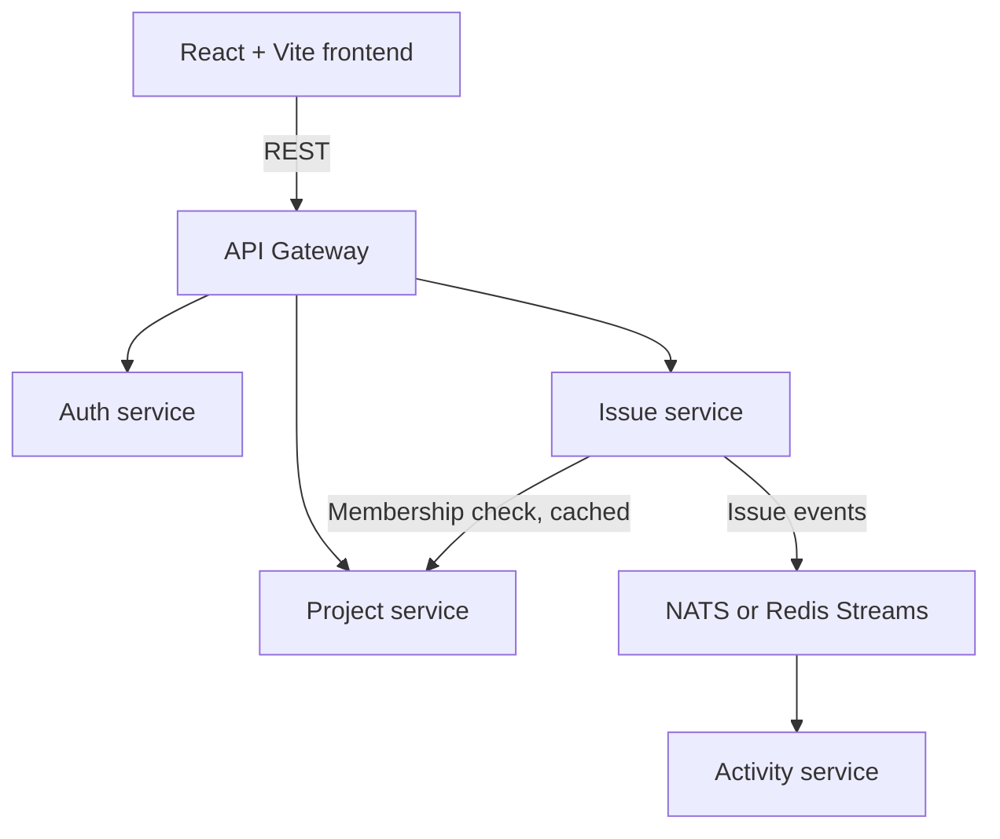

# Bug / Issue Tracker

A project and issue tracking application built as a Go microservices system with a React frontend and MySQL. This repository is currently at the planning stage; the implementation and runnable development commands will be added as the phases below are completed.

## Project goals

- Manage projects, project members, issues, labels, and issue activity.
- Provide authenticated APIs through a single gateway.
- Keep each service responsible for its own data and database.
- Demonstrate practical data structures and algorithms in tested, focused packages.
- Run the system locally with Docker Compose when the foundation phase is implemented.

## Planned architecture

| Component | Responsibilities | Data store |
|---|---|---|
| API Gateway | Routing, JWT validation, rate limiting | None |
| Auth service | Registration, login, roles, JWT issuing | `auth_db` |
| Project service | Projects, members, membership checks | `project_db` |
| Issue service | Issues, labels, filtering, search, dependencies | `issue_db` |
| Activity service | Activity log and feed from issue events | `activity_db` |

Each service owns its database and accesses another service only through its API. The Issue service stores user IDs rather than joining against Auth data. It checks project membership through the Project service, with a timeout and an LRU cache. Issue creation and status changes are sent asynchronously to the Activity service through a broker.

## Planned technology

- **Backend:** Go services, layered as middleware/handler/service/repository
- **Frontend:** React and Vite
- **Storage:** MySQL, with schema migrations
- **Authentication:** bcrypt password hashing and JWT
- **Service API:** REST or gRPC for synchronous service calls; API contracts in `contracts/`
- **Events:** NATS or Redis Streams (choice to be finalized)
- **Local environment and CI:** Docker Compose and GitHub Actions

## Planned features

- User registration and login with `admin` and `member` roles
- Project CRUD and project membership management
- Issue CRUD, labels, filtering, keyword search, sorting, and keyset pagination
- An activity feed populated from issue events
- A React UI for projects and issues, including filters and a status-grouped Kanban view
- Health/readiness endpoints, structured logs, request IDs, graceful shutdown, and outgoing-call timeouts

### Data structures and algorithms

- LRU cache for project-membership checks
- Dependency graph with cycle detection and topological ordering
- Trie for label and username autocomplete
- Token-bucket rate limiter in the gateway
- Optional: priority queue and Union-Find

## Build roadmap

The work is planned in phases so each service and its documentation can be developed and validated incrementally:

1. **Foundation:** monorepo, Compose, migrations, CI, and health-check template
2. **Authentication:** Auth service and API gateway
3. **Projects:** Project CRUD, membership management, and membership API
4. **Issues:** Issue service, safe filtering/search, keyset pagination, and LRU cache
5. **Events:** broker integration and Activity service
6. **DSA:** dependency graph, trie, rate limiter, and tested LRU package
7. **Frontend:** React application using the gateway
8. **Ship:** tests, observability, seed data, and final documentation

See [`Build_Plan_Bug_Issue_Tracker.md`](Build_Plan_Bug_Issue_Tracker.md) for the detailed app and assignment plan.

## Getting started

The repository does not yet contain the application services or development environment, so there are no runnable setup commands at this stage. Once Phase 0 is implemented, this section will document prerequisites, environment variables, database migrations, and the Docker Compose startup command.

## Documentation

- [`Build_Plan_Bug_Issue_Tracker.md`](Build_Plan_Bug_Issue_Tracker.md) — detailed phased build plan
- `docs/ARCHITECTURE.md` — planned home for architecture decisions and service/event-flow diagrams
