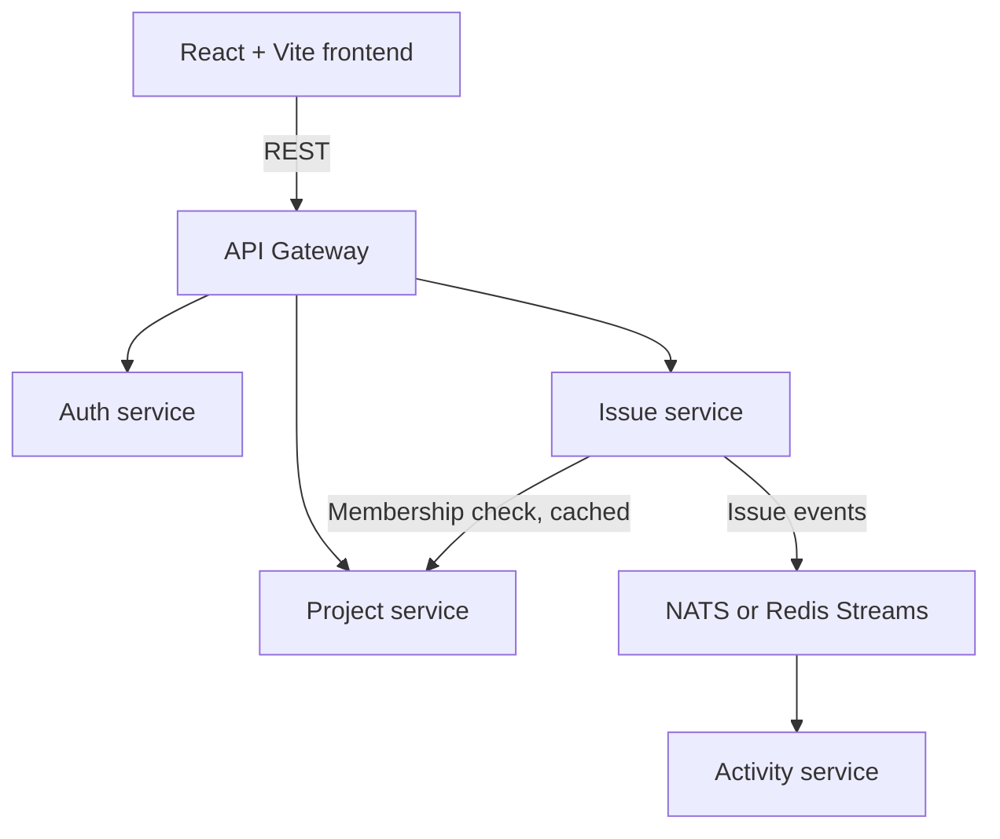

# Trackline

Trackline is a project and issue tracking application built as a Go microservices system with a React frontend and MySQL.

## Project goals

- Manage projects, project members, issues, labels, and issue activity.
- Provide authenticated APIs through a single gateway.
- Keep each service responsible for its own data and database.
- Demonstrate practical data structures and algorithms in tested, focused packages.
- Run the system locally with Docker Compose.

## Planned architecture



| Component | Responsibilities | Data store |
|---|---|---|
| API Gateway | Routing, JWT validation, rate limiting | None |
| Auth service | Registration, login, roles, JWT issuing | `auth_db` |
| Project service | Projects, members, membership checks | `project_db` |
| Issue service | Issues, labels, filtering, search, dependencies | `issue_db` |
| Activity service | Activity log and feed from issue events | `activity_db` |

Each service owns its database and accesses another service only through its API. The Issue service stores user IDs rather than joining against Auth data. It checks project membership through the Project service, with a timeout and an LRU cache. Issue creation and status changes are sent asynchronously to the Activity service through a broker.

## Planned technology

- **Backend:** Go services, layered as middleware/handler/service/repository
- **Frontend:** React and Vite
- **Storage:** MySQL, with schema migrations
- **Authentication:** bcrypt password hashing and JWT
- **Service API:** REST or gRPC for synchronous service calls; API contracts in `contracts/`
- **Events:** NATS
- **Local environment and CI:** Docker Compose and GitHub Actions

## Planned features

- User registration and login with `admin` and `member` roles
- Project CRUD and project membership management
- Issue CRUD, labels, filtering, keyword search, sorting, and keyset pagination
- An activity feed populated from issue events
- A React UI for projects and issues, including filters and a status-grouped Kanban view
- Health/readiness endpoints, structured logs, request IDs, graceful shutdown, and outgoing-call timeouts

### Data structures and algorithms

- LRU cache for project-membership checks
- Dependency graph with cycle detection and topological ordering
- Trie for label and username autocomplete
- Token-bucket rate limiter in the gateway
- Optional: priority queue and Union-Find

## Implemented

- Docker Compose development stack: MySQL, golang-migrate, NATS, gateway, auth,
  project, issue, activity, and frontend containers.
- Auth registration/login with bcrypt and HS256 JWTs; protected gateway proxy.
- Project CRUD and membership checks; issue CRUD, filtering, labels, and
  keyset pagination; NATS-powered activity feed.
- Shared liveness/readiness handlers and request-ID middleware.
- Tested LRU, dependency graph, trie, and token-bucket packages.
- Issue dependency creation rejects cycles using the graph package.
- Supported issue sorting, the dependency work-order endpoint, and trie-backed
  label/username autocomplete are available through the gateway.
- Service handler and gateway tests cover validation, authorization, routing,
  membership calls, and idempotent activity-event persistence.
- Responsive React UI for login, projects, and issue tracking.
- Issue detail/edit dialog, URL-persisted search/status/priority filters, and
  loading and empty states.
- Project-scoped manager/admin roles, team controls, project-member issue
  assignment, and a schedule calendar with planned dates and work milestones.
- Usable My Issues, Activity, and Analytics sections: assigned issues across
  projects, a merged recent activity feed, and current per-project counts.
- Global-admin user directory with admin-initiated temporary password resets
  and mandatory password changes on next sign-in, account creation, and
  deactivation/reactivation.
- Global admins can assign active accounts to projects from the Users page;
  project managers retain project-scoped member controls.

## Build roadmap

The work is planned in phases so each service and its documentation can be developed and validated incrementally:

1. **Foundation:** monorepo, Compose, migrations, CI, and health-check template
2. **Authentication:** Auth service and API gateway
3. **Projects:** Project CRUD, membership management, and membership API
4. **Issues:** Issue service, safe filtering/search, keyset pagination, and LRU cache
5. **Events:** broker integration and Activity service
6. **DSA:** dependency graph, trie, rate limiter, and tested LRU package
7. **Frontend:** React application using the gateway
8. **Ship:** tests, observability, seed data, and final documentation

See [`Trackline.md`](Trackline.md) for the detailed app and assignment plan.

## Getting started

### Prerequisites

- Docker Engine and the Docker Compose plugin
- GNU Make
- Go 1.24+ (for local tests)
- Node.js 20+ and npm (for the frontend)
- `golangci-lint` (for `make lint`)

### Common development commands

Run `make` or `make help` to list targets. Examples:

```sh
make docker-up                                     # MySQL, NATS, then migrations
make run-trackline                                  # run frontend + backend locally
make run-backend                                   # run Go services locally
make run-frontend                                  # run the Vite frontend locally
make migrate-up                                    # migrate all service databases
make migrate-up MIGRATE_DATABASE=issue_db          # migrate one database
make migrate-status MIGRATE_DATABASE=issue_db
make migrate-down MIGRATE_DATABASE=issue_db        # roll back one migration
make docker-app-up                                 # run the entire stack in containers
python3 scripts/seed.py                            # idempotently seed demo data
make docker-status && make docker-down             # inspect, then stop containers
PLAYWRIGHT_BASE_URL=http://localhost:3000 npm --prefix frontend run test:e2e
make test && make lint
make build
```

For local app execution, start dependencies with `make docker-up` first. The
run targets use `.env` for credentials and published dependency ports. Run
`cd frontend && npm ci && npx playwright install chromium` once before local
frontend builds and browser tests. The
local Vite UI listens on `http://localhost:5173`; the local gateway listens on
`http://localhost:8082`.

`migrate-up` applies pending migrations to all service databases by default;
set `MIGRATE_DATABASE` to target one. `migrate-status` reports the applied
version and pending versions, or the migration error/dirty state. `migrate-down`
rolls back one migration in `auth_db` by default; select another database with
`MIGRATE_DATABASE` and adjust the step count with `MIGRATE_STEPS` if needed.
Rollback changes schema and may remove data.

Override the Compose file when needed, for example:

```sh
make docker-status COMPOSE_FILE=compose.override.yml
```

`make docker-down` does not remove volumes. To intentionally delete the local
MySQL data, use `docker compose down -v` separately; this is destructive and
cannot be undone.

### Start the development stack

Create a local environment file and set strong, non-empty secrets before
starting Compose. Use hexadecimal values so the MySQL migration URL remains
unambiguous:

```sh
cp .env.example .env
openssl rand -hex 24  # use the output for MYSQL_ROOT_PASSWORD
openssl rand -hex 32  # use the output for JWT_SECRET
```

Edit `.env` to set both values. Compose refuses to start if either is missing.
Published MySQL and NATS ports bind to localhost only by default.

```sh
make docker-up
```

This starts MySQL and NATS and applies migrations, but does not start the app.
For local development, run `make run-trackline` in another terminal. The legacy
`run-bug-issue-tracker` Make target remains available as an alias.
For the all-container setup, use `make docker-app-up`; the UI is available at
`http://localhost:3000` and gateway at `http://localhost:8082`. MySQL is
available at `localhost:3306` (localhost only), with separate `auth_db`,
`project_db`, `issue_db`, and `activity_db` databases. To stop the containers:

The seed script uses demo accounts `demo.admin@example.test` and
`demo.member@example.test` with local-development passwords. Override them with
`SEED_ADMIN_EMAIL`, `SEED_ADMIN_PASSWORD`, `SEED_MEMBER_EMAIL`, and
`SEED_MEMBER_PASSWORD` before running it. Set `TRACKER_URL` when the gateway is
not at `http://localhost:8082`.

```sh
make docker-down
```

To remove the local database data as well, run `docker compose down -v`.


## Documentation

- [`Build_Plan_Bug_Issue_Tracker.md`](Trackline.md) — detailed phased build plan
- [`docs/ARCHITECTURE.md`](docs/ARCHITECTURE.md) — architecture and service/event-flow details
- [`docs/TESTING.md`](docs/TESTING.md) — Go, Playwright, seed, and verification notes
- [`docs/CONTEXT.md`](docs/CONTEXT.md) — implementation and environment context
- [`docs/PROJECT_MANAGEMENT.md`](docs/PROJECT_MANAGEMENT.md) — roles, assignment, calendar, and YouTrack-inspired scope
- [`docs/DEPLOYMENT.md`](docs/DEPLOYMENT.md) — GitHub Pages frontend and Render free-tier backend deployment
- [`docs/AGENTS-SKILLS.md`](docs/AGENTS-SKILLS.md) — agent and skill notes
